<div align="center">


# ambagan

**Split it, settle it.**

A small, self-hosted payment portal for friends who chip in for something they share: a Spotify family plan, the internet bill, last night's dinner.
Everyone gets a statement. Everyone pays in their own wallet app. You check it against your own account. Nothing else needed.

[](https://github.com/thekovie/ambagan/actions/workflows/ci.yml)


<br />

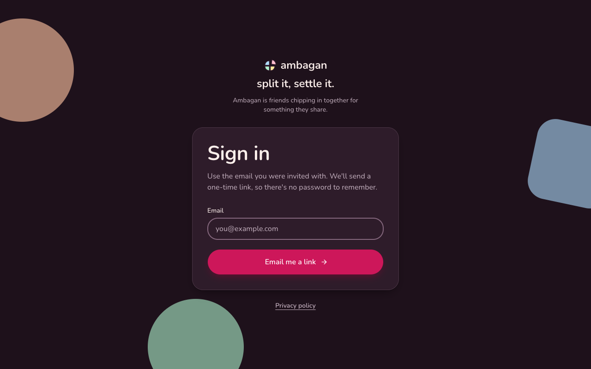

</div>

<br />

> **Ambagan** (Tagalog) is the act of friends pooling money for something they share.
> This app is built for a group of about 3 to 6 people in the Philippines (PHP, Asia/Manila time, GCash, Maya and bank transfers), but nothing stops you using it elsewhere.

## Why it exists

Group chats are a bad ledger. Someone sends a screenshot, someone else forgets, and the person who fronts the money ends up scrolling back through weeks of messages to work out who still owes what.

ambagan is the boring, friendly fix:

- **No money moves through it.** Members pay your GCash, Maya or bank account directly. ambagan only keeps the books.
- **You are the source of truth.** A payment counts only when you approve it after finding it in your own account. No bank integration, no guessing.
- **No receipt is ever stored.** Members can scan a receipt screenshot to fill in the form, but the image is read inside their browser and never uploaded.
- **No passwords.** Sign-in is an emailed one-time link, and only people you invite can get in.
- **One container, one volume.** SQLite, about 50 MiB of memory at idle, daily backups built in.

## What you get

| | |
|---|---|
| **Monthly statements** | Every active member gets a statement on the plan's issue day (default the 1st, due the 10th), plus an email. Someone who joins after the due day starts next month. |
| **Report, then verify** | Members pay outside the app, then report the reference number, amount, time and the app they paid from. You see what they owed next to what they claim, then approve or decline (a decline needs a reason, and they can report again). |
| **Receipt scanning** | Optional, in-browser OCR ([Tesseract.js](https://github.com/naptha/tesseract.js)) fills the form from a screenshot. Every field is shown for the member to check. |
| **Ambag** | One-off bills you fronted, such as dinner or a gift. Split equally, by shares, by percent, by exact amounts or by receipt items. |
| **Friends without an account** | Add someone with just a name and they pay through a private link that only they have. |
| **Late penalties** | Optional per plan: an amount every N days late, with an optional cap. Counting stops when they report paying, it rolls onto the next monthly statement, and you can waive any of it. |
| **Your payment methods** | Add GCash, Maya, a bank or anything else yourself, with account details and a QR code. Nothing is hard-coded. |
| **Reminders** | Friendly emails the day before, the day of and weekly once overdue, to people who still owe and nobody else. |
| **Built-in guide** | A short "How it works" page and a welcome card for new members, written for their role. |
| **Privacy by design** | A plain-language privacy page under the Philippine Data Privacy Act (RA 10173), and an admin tool to erase a former member's personal data. |
| **Looks good on a phone** | Mobile-first with a floating dock, light and dark themes, a themed 404 and loading states. |

## A look around

<table>
  <tr>
    <td width="50%" valign="top">
      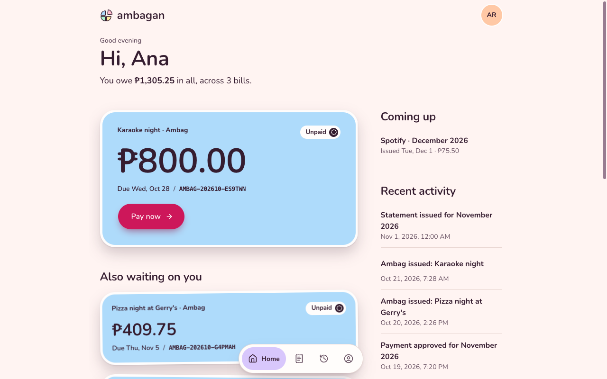
      <p align="center"><sub><b>Home.</b> What you owe, biggest bill first.</sub></p>
    </td>
    <td width="50%" valign="top">
      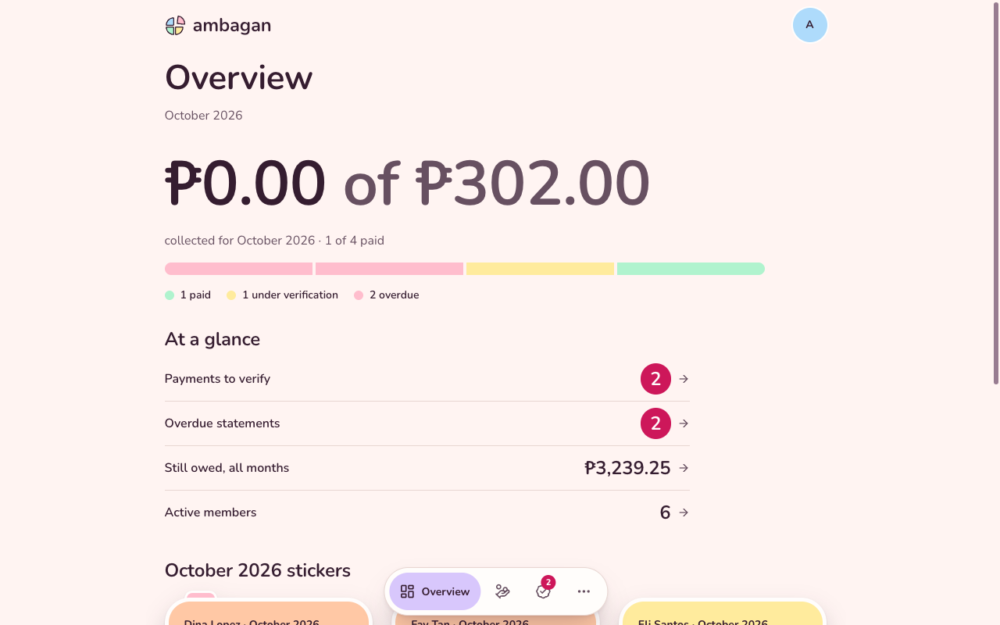
      <p align="center"><sub><b>Overview.</b> The admin's month at a glance.</sub></p>
    </td>
  </tr>
  <tr>
    <td width="50%" valign="top">
      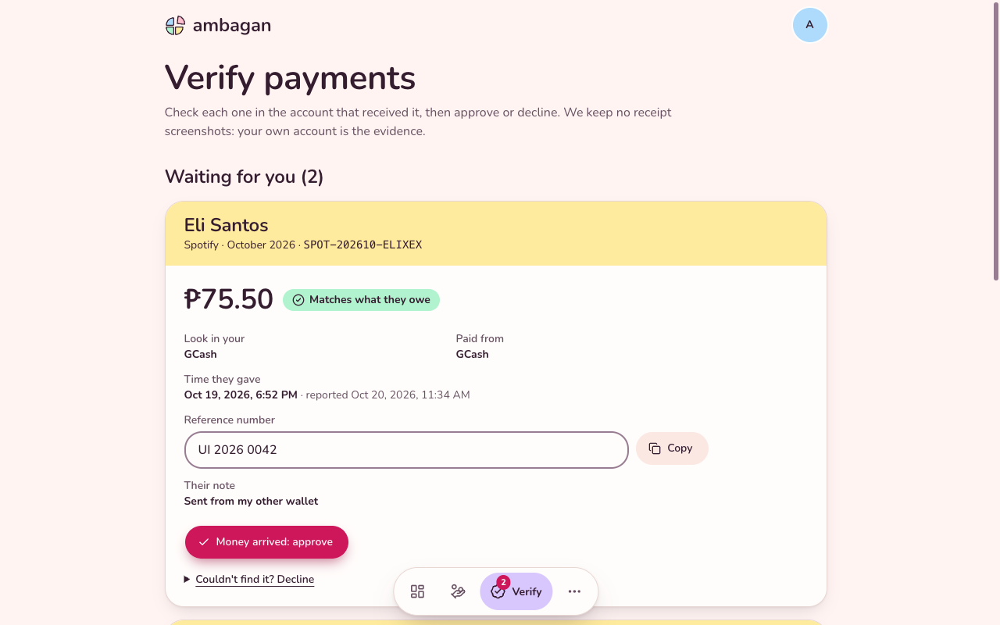
      <p align="center"><sub><b>Verify.</b> Check it in your own account, then approve or decline.</sub></p>
    </td>
    <td width="50%" valign="top">
      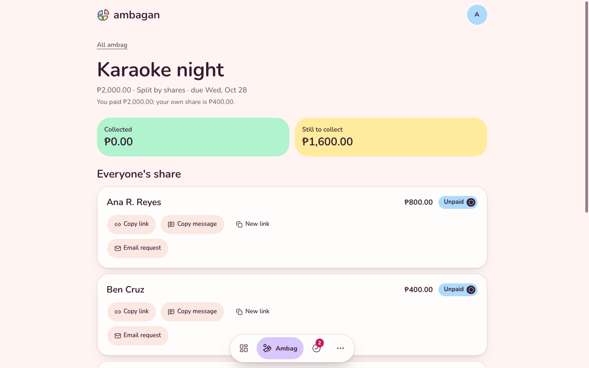
      <p align="center"><sub><b>Ambag.</b> One-off bills, each friend gets their share.</sub></p>
    </td>
  </tr>
  <tr>
    <td width="50%" valign="top">
      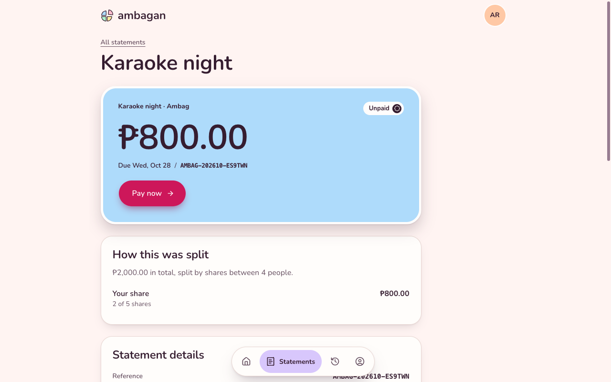
      <p align="center"><sub><b>Statement.</b> Exactly how the amount was worked out.</sub></p>
    </td>
    <td width="50%" valign="top">
      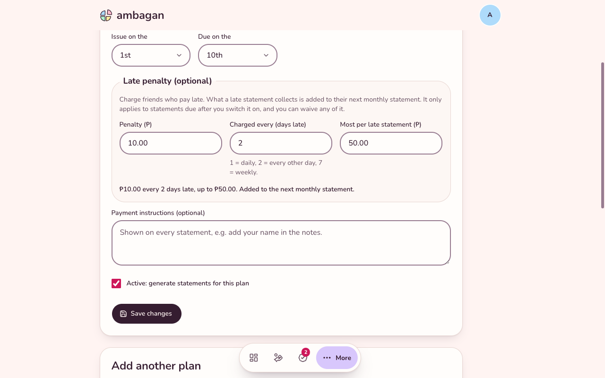
      <p align="center"><sub><b>Plans.</b> Fees, dates and an optional late penalty.</sub></p>
    </td>
  </tr>
  <tr>
    <td width="50%" valign="top">
      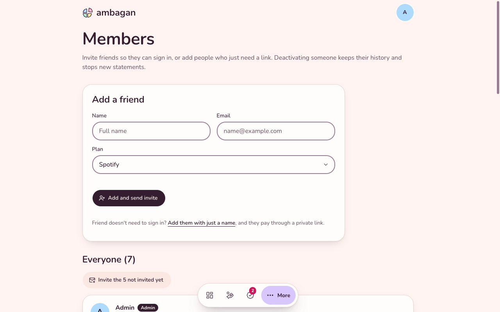
      <p align="center"><sub><b>Members.</b> Invite by email or add by name.</sub></p>
    </td>
    <td width="50%" valign="top">
      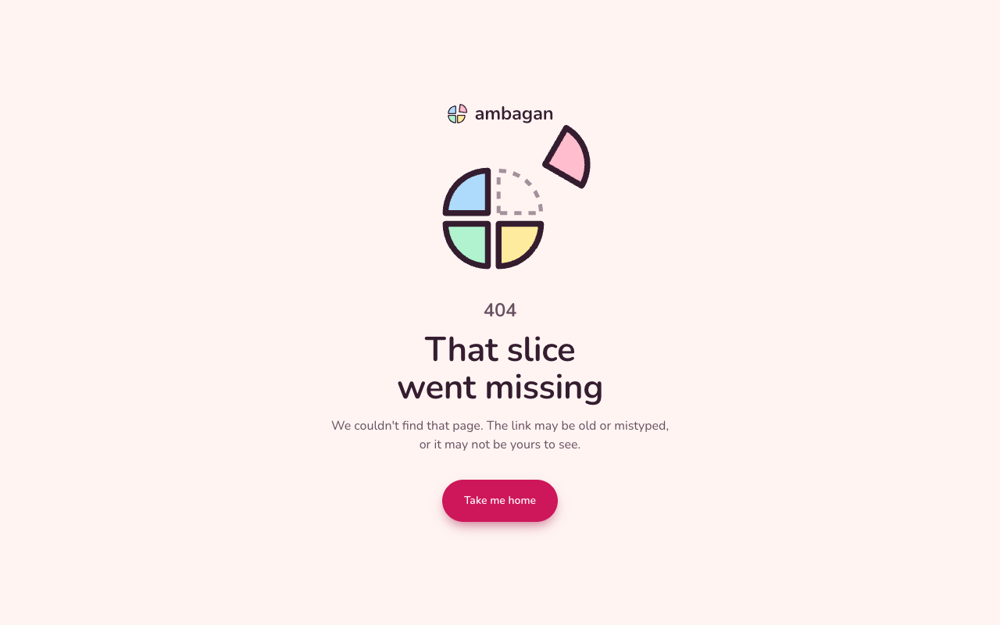
      <p align="center"><sub><b>404.</b> Even the dead ends are on theme.</sub></p>
    </td>
  </tr>
</table>

<p align="center">
  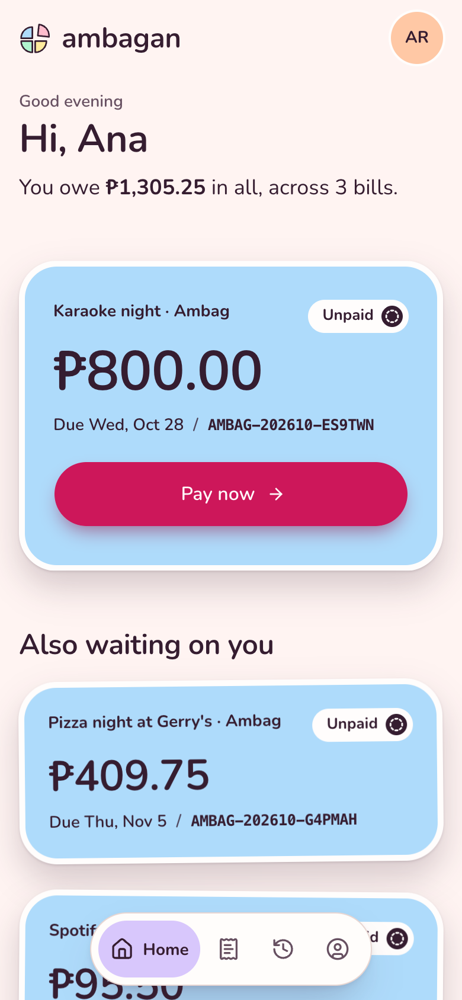
  &nbsp;&nbsp;&nbsp;
  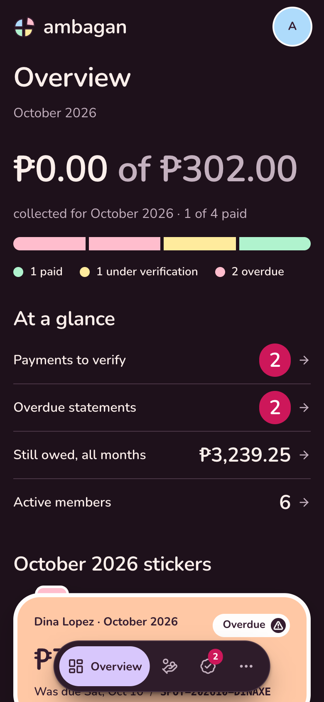
</p>
<p align="center"><sub>Made for phones first. Light and dark follow your device.</sub></p>

<sub>Screenshots use made-up demo data.</sub>

## How it works

1. **Invite.** You invite friends by email. Sign-in is a one-time emailed link.
2. **Statement.** Each month (Asia/Manila), every active member gets a statement and an email. Default is PHP 50.00 due on the 10th, and you set the real amount per plan.
3. **Pay.** The member opens the statement, pays one of your payment methods in their own app, then reports it. **Scan receipt** can read the reference, amount and time from a screenshot, inside the browser.
4. **Verify.** The statement shows **Waiting for check**. You find the transaction in your own account and approve or decline. Only your approval marks a statement paid.
5. **Done.** Everyone is emailed at each step. Reminders go only to people who still owe.

## Run it

### With Docker

```bash
git clone https://github.com/thekovie/ambagan.git && cd ambagan
cp .env.example .env     # set AUTH_SECRET (openssl rand -base64 32), ADMIN_EMAIL, APP_URL and SMTP_*
docker compose up -d --build
docker compose ps        # wait for "healthy"
```

Open the app and sign in with `ADMIN_EMAIL`: that address becomes the first administrator. Put a TLS reverse proxy (Caddy, nginx, Traefik) in front for real use. The container refuses to start, with the reason in `docker compose logs`, if configuration is missing or invalid.

### On a platform like Coolify

Build from the `Dockerfile`, expose port 3000, mount a persistent volume at `/data` (it holds the database, backups and QR images) and set the variables below. Migrations apply on start.

### Configuration

| Variable | Notes |
|---|---|
| `APP_URL` | Public address, for example `https://pay.example.com`. Must be `https` in production. |
| `AUTH_SECRET` | `openssl rand -base64 32`. Changing it signs everyone out. |
| `ADMIN_EMAIL` | The first administrator. |
| `SMTP_*` | Required in production. Without it (development only), emails print to the console. See [docs/email.md](docs/email.md). |
| `PRIVACY_EMAIL` | Optional. The address the privacy page tells people to write to. |
| `BACKUP_DIR`, `BACKUP_KEEP` | Optional. Where daily backups go and how many to keep (default 14). |

After starting, press **Admin → Emails → Send me a test email** to confirm SMTP works. Copy backups off the machine; see [docs/backup-restore.md](docs/backup-restore.md). Full guide: [docs/deployment.md](docs/deployment.md).

## Development

```bash
nvm use                  # Node 22
pnpm install
cp .env.example .env     # fill AUTH_SECRET and ADMIN_EMAIL
pnpm dev
```

| Command | What |
|---|---|
| `pnpm typecheck` / `pnpm lint` | types and lint |
| `pnpm test` | 700+ unit and integration tests (real SQLite, real migrations) |
| `pnpm e2e` | the full journey in a real browser against the production build (first: `pnpm exec playwright install chromium`) |
| `pnpm build` | production build (also copies the OCR engine into `public/ocr`) |
| `pnpm db:generate` | create a migration after editing `src/server/db/schema.ts` |

CI runs typecheck, lint, tests, a production build, a Docker build with a health check, the end-to-end journey and a dependency audit on every pull request.

## Built with

[Next.js 16](https://nextjs.org) (App Router) · TypeScript · [Tailwind CSS v4](https://tailwindcss.com) · [shadcn/ui](https://ui.shadcn.com) · SQLite with [Drizzle](https://orm.drizzle.team) · [Auth.js](https://authjs.dev) (passwordless email links) · [Nodemailer](https://nodemailer.com) · [Tesseract.js](https://github.com/naptha/tesseract.js) · [Playwright](https://playwright.dev) and [Vitest](https://vitest.dev) · Docker

## What runs on its own

A one-minute timer inside the app. After 08:00 Manila time it takes the **daily backup**, then runs the **daily job** (issues the month's statements, marks late ones overdue, accrues penalties, queues reminders), each at most once per day with catch-up after downtime. It also sends any email that is due or waiting to retry. Admins can run both by hand. Details in [docs/billing.md](docs/billing.md#scheduled-jobs-the-daily-run) and [docs/email.md](docs/email.md).

## Documentation

| | |
|---|---|
| [docs/architecture.md](docs/architecture.md) | how it fits together, conventions, the payment journey |
| [docs/database.md](docs/database.md) | tables, the rules the database enforces, migrations |
| [docs/authentication.md](docs/authentication.md) | invitation-only sign-in, sessions, roles, rate limiting |
| [docs/billing.md](docs/billing.md) | statements, statuses, penalties, cancellation, the daily run |
| [docs/payments.md](docs/payments.md) | reporting and verifying a payment |
| [docs/ocr.md](docs/ocr.md) | in-browser receipt scanning and its limits |
| [docs/email.md](docs/email.md) | SMTP setup, the queue, what is sent |
| [docs/deployment.md](docs/deployment.md) | Docker, reverse proxy, security headers, updating, troubleshooting |
| [docs/backup-restore.md](docs/backup-restore.md) | daily backups, off-machine copies, restoring |
| [docs/testing.md](docs/testing.md) | test layers, coverage, what is not covered |
| [PROJECT_LOG.md](PROJECT_LOG.md) | every decision, issue and deviation, with the reasoning |
| [PRODUCT.md](PRODUCT.md), [DESIGN.md](DESIGN.md) | who it is for and the visual system |

## Troubleshooting

The quick answers are in [docs/deployment.md](docs/deployment.md#troubleshooting). The usual suspects: a wrong `APP_URL` (links in emails point to the wrong place), SMTP not working (the **Emails** page shows the error), or a reverse proxy that doesn't forward `X-Forwarded-For` or allows less than 2 MB request bodies.

## Known limitations

- **Receipt scanning has only been tested on synthetic receipts.** Accuracy on real GCash, Maya and MariBank screenshots is unmeasured, which is why every field is shown for the member to confirm. It can be skipped entirely.
- **Payments are whole-statement.** A different amount is only accepted if the admin records why (treating it as settled in full). There are no partial payments or allocations.
- **Verification is manual by design.** There is no bank or wallet integration, and no receipt is stored, so the admin's own account is the evidence.
- Email was verified against a local TLS SMTP server, not yet a hosted provider. Delivery to an inbox can't be confirmed: "Sent" means the mail server accepted it.
- Only the current Manila month is issued automatically. If the app was down for a plan's whole issue-day-to-month-end window, use **Generate missing** by hand.
- An admin who is also a member can approve their own payment (every approval is audited).
- No PDF export (use the browser's print). Backups are daily, so up to a day of changes can be lost. Auth.js v5 is still a beta release.
- Verified on arm64 locally. CI builds and smoke-tests the image on amd64.
- The privacy page is a plain-language notice drafted to the Data Privacy Act's transparency and rights requirements. It is not legal advice.
